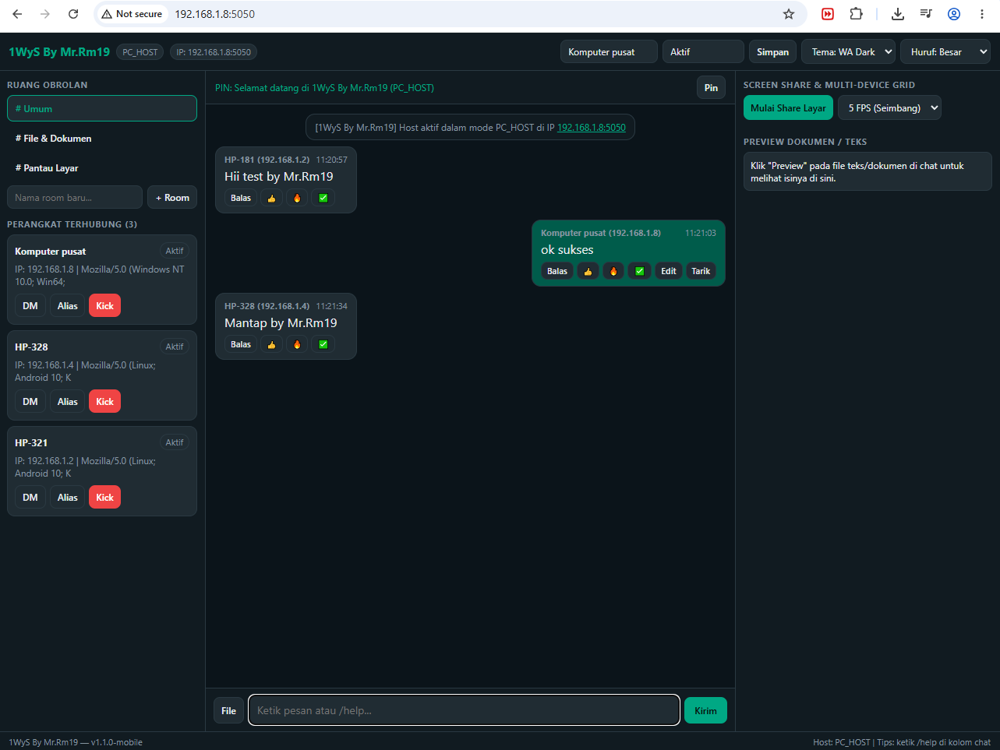

# 1WyS By Mr.Rm19

**1WyS** (*1 Wi-Fi yang Sama*) adalah aplikasi **LAN Chat Hub**, **File & Document Transfer**, serta **Screen Share Multi-Device Grid** yang dirancang dengan **satu basis kode tunggal** untuk dijalankan sebagai host di **Komputer (PC)** maupun **HP Android (Termux)**, sementara perangkat kliencukup mengaksesnya melalui **Web Browser**.

---


* **Dual-Host Architecture (`PC_HOST` & `TERMUX_HOST`):** Mendeteksi lingkungan secara otomatis dan berjalan di PC saat di rumah atau di HP Termux saat berada di luar tanpa membawa komputer.
* **WhatsApp-Style Real-Time Chat:** Gelembung pesan terpisah (pesan sendiri vs perangkat lain), stempel waktu, balasan kutipan (*reply/quote*), reaksi emoji cepat, edit pesan, dan tarik pesan (*unsend for all*).
* **Multi-Room & Direct Message (DM):** Mendukung pembuatan ruang obrolan tambahan, penyematan pengumuman (*pin banner*), serta pesan privat langsung antar alamat IP di LAN.
* **File & Document Sharing + Preview:** Unggah gambar dan dokumen ke folder terpusat (`uploads_1wys/`), pratinjau gambar langsung di chat, serta pratinjau isi file teks/dokumen ringan pada panel *preview*.
* **Screen Share & Multi-Device Viewer Grid:** Berbagi tampilan layar dari browser yang mendukung `getDisplayMedia` ke *grid* pemantau multi-perangkat dengan pengatur batas **FPS** (3 / 5 / 10 FPS) untuk menjaga stabilitas jaringan lokal.
* **Connected Devices Radar & Host Controls:** Memantau perangkat yang terhubung beserta IP lokal, *user-agent* ringkas, *status tag*, penetapan **alias/label** tetap berdasarkan IP, serta fitur **Kick** perangkat.
* **Responsive Desktop & Mobile UI:** Tata letak 3 kolom di layar lebar dan navigasi tab khusus di layar HP (`Chat`, `Room & HP`, `Layar & File`) beserta modal pengaturan profil, tema (*WA Dark*, *Terang*, *Matrix*), dan ukuran huruf.
* **Productivity Utilities:** Mendukung perintah cepat *slash commands* (`/help`, `/who`, `/clear`, `/pin <teks>`, `/room <nama>`) serta deteksi otomatis tautan dan alamat IP lokal.

---

```
pip install -r requirements.txt
python app.py
Catat alamat http://<IP-KOMPUTER>:5050 yang muncul di terminal, lalu buka alamat tersebut di browser HP-HP lain dan komputer.
```

## Mode 2: Host di HP (Termux)
Saat berada di luar tanpa komputer, aktifkan termux-wake-lock agar proses Python tidak mudah dihentikan sistem saat layar mati, lalu jalankan:

```
termux-wake-lock
python app.py
```
Akses dari HP-HP lain di jaringan yang sama melalui http://<IP-HP-TERMUX>:5050.

## Konfigurasi Port Opsional
Untuk mengubah port bawaan (5050), atur environment variable PORT_1WYS:

PORT_1WYS=8080 

---
## tampilan 


---

### Technical Notes
Konektivitas LAN: Seluruh perangkat harus berada pada jaringan lokal yang sama (Wi-Fi router yang sama atau hotspot yang sama) dan tidak terblokir AP isolation maupun firewall.

Screen Share Browser: Fitur berbagi layar mengandalkan API navigator.mediaDevices.getDisplayMedia pada browser yang mendukung; ketersediaan fitur ini bergantung pada dukungan masing-masing browser dan sistem operasi perangkat.

Penyimpanan State: Riwayat pesan, ruang, dan daftar sesi aktif saat ini disimpan di memori selama proses server berjalan, sedangkan 
file unggahan tersimpan di folder uploads_1wys/.

---

!@ Author
Mr.Rm19 — github.com/Rm19x  @!
